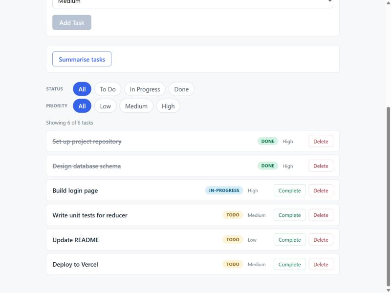

# TaskFlow Web

A React frontend for the [TaskFlow API](https://github.com/DAMI333N/taskflow-api).
It lists, adds, edits, completes, deletes and filters tasks, with every change
read from and written to the API. It can also ask the API for an AI summary of
the task list.

Built for NTU AI Engineering, Module 4, stretch Option 2. It started from my
Module 2 React app and replaces its local state and `localStorage` with the
API.

Live site: `https://<site-name>.netlify.app` (placeholder until deployed)



## Features

- Task list at `/tasks`, loaded from `GET /api/tasks`, with status badge and
  priority on every row
- Task detail page at `/tasks/:id`, fetched from `GET /api/tasks/{id}`, so deep
  links and refreshes work
- Add form (`POST`), inline edit form (`PUT`, full replace), Delete (`DELETE`)
  and Complete (`PUT /api/tasks/{id}/complete`)
- Summarise button calling `GET /api/tasks/summary`
- Filters by status and by priority, both active at once
- Loading text while requests run, the API's own error message when one fails,
  and a Retry button when the list cannot load
- "Task not found" page that shows the API's 404 message for an unknown id
- `/` and unknown URLs redirect to `/tasks`

## Tech stack

- React 19 with Vite
- React Router for client-side routing
- `useReducer` and `useContext` for state, `fetch` for HTTP, no extra libraries
- Plain CSS

## Getting started

You need Node 22 and a running TaskFlow API (see its README to run it locally on
port 8080).

```bash
git clone https://github.com/DAMI333N/taskflow-web
cd taskflow-web
npm install
```

Create `.env.development` in the project root, using `.env.example` as the
template, and point it at the API with no trailing slash:

```
VITE_API_BASE_URL=http://localhost:8080
```

Then start the dev server:

```bash
npm run dev
```

It serves the app on `http://localhost:5173`, which is the origin the API allows
by default.

Other scripts:

```bash
npm run build     # production build into dist/
npm run preview   # serve the production build
npm run lint      # ESLint
```

## Deploying to Netlify

- Build command `npm run build`, publish directory `dist`
- Set `VITE_API_BASE_URL` to the deployed API URL in the site's environment
  variables. Vite reads it at build time, so redeploy after changing it.
- `public/_redirects` sends every path to `index.html`, so a refresh on
  `/tasks/3` loads the app instead of a Netlify 404
- The API must list the Netlify origin in `taskflow.cors.allowed-origins`,
  otherwise the browser blocks every request

## Project structure

```
src/
  main.jsx                    provider, router and app mounted here
  App.jsx                     header plus route definitions
  api/tasksApi.js             every call to the TaskFlow API
  reducer/taskReducer.js      FETCH_START, FETCH_SUCCESS, FETCH_ERROR,
                              ADD_TASK, UPDATE_TASK, DELETE_TASK,
                              SET_FILTER, SET_PRIORITY_FILTER
  context/TaskContext.jsx     loads tasks, exposes data and async actions
  components/                 Header, AddTaskForm, SummaryPanel, FilterBar,
                              TaskList, TaskItem
  pages/                      TaskListPage, TaskDetailPage
```

## How data flows

The server is the source of truth. `src/api/tasksApi.js` holds every request
behind one helper that checks `response.ok` and, on failure, throws an `Error`
carrying the message from the API's `{ status, message, timestamp }` body and
the HTTP status. Components never call `fetch` directly.

`TaskProvider` loads the list on mount, and again whenever Retry is pressed: it
dispatches `FETCH_START`, then
`FETCH_SUCCESS` with the server's tasks or `FETCH_ERROR` with the message. An
`ignore` flag in the effect's cleanup discards a stale response, which matters
because React StrictMode mounts twice in development.

`addTask`, `updateTask`, `completeTask` and `deleteTask` call the API first and
dispatch only after it succeeds, using the task the server returns. Nothing is
updated optimistically, so the screen never shows a change the server rejected.
Each action rethrows on failure, so the form or button that started it shows the
error next to itself and keeps the user's input. A 404 on delete, edit or
complete means another client already deleted the task, so it is dropped from
the list to match the server. The add form only appears once the list has
loaded, so a new task can never be overwritten by an older fetch result.

The list held in the reducer is a client-side copy of the server's data. It is
not re-fetched when you navigate between pages, so changes made by another
browser or client show up after a reload or a Retry.

The detail page fetches its own task by id instead of searching the list. A 404
or 400 from the API shows "Task not found" with the server's message. Saving an
edit or completing the task updates both the page and the list from the
server's response.

`filteredTasks` is derived during render from `tasks` and the two filters. It is
never stored, so it cannot drift out of sync with the list.

## Why reordering was removed

The Module 2 version let you drag rows into a new order. The TaskFlow API
returns tasks in creation order and stores no order field, so a reorder made in
the browser could never be saved: it would silently reset on the next reload.
Rather than show a control that quietly loses your work, drag-and-drop and the
`REORDER_TASKS` action were removed.

## The summary button

`GET /api/tasks/summary` asks the API to summarise the task list with a language
model. When the API has no model key configured it returns 502, and the page
shows the API's message under the button instead of failing. That is the
expected result on the live site.

## AI and Tools

- **Claude Code** (Anthropic) planned the migration from my step list, then
  implemented it one step per commit. I approved the plan before any code was
  written and reviewed each step's diff, browser check and commit.
- **react-patterns skill** (ECC plugin for Claude Code) guided the state and
  data-fetching design, such as the effect cleanup flag and keeping derived data
  out of state.
- **react-reviewer agent** (ECC plugin) reviewed the finished change set. It
  found no critical or high issues and raised medium and low ones: a race
  between adding a task and a list fetch, rows stuck after a 404, missing
  screen-reader announcements and focus handling, colour contrast, and README
  wording. Those were fixed in a follow-up commit; two minor performance notes
  were left as they are at this app's size.
- **Claude Code's Browser pane** ran every step against the real API through an
  SSH tunnel, checking network requests and the console.
- Vite, ESLint, Git and the GitHub CLI for building, linting and version
  control; Netlify for hosting.

No code was copied from external sources beyond the React, React Router and Vite
documentation.
