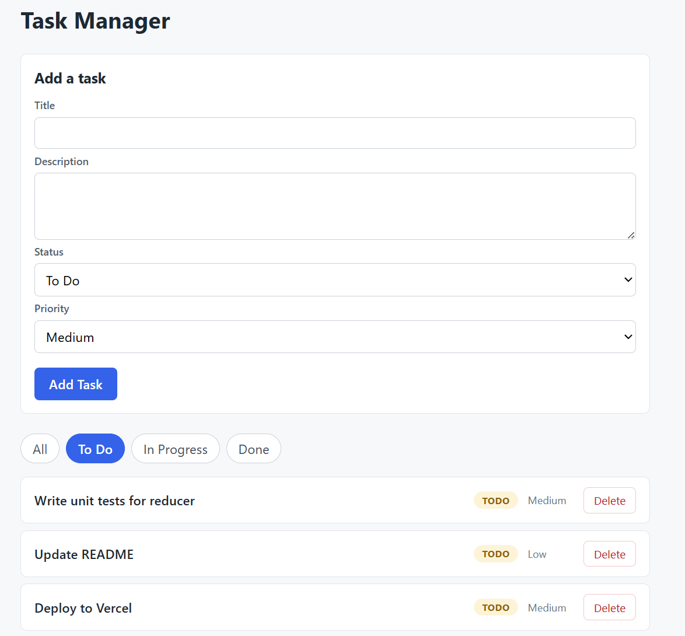

# Task Manager

A small React app for viewing, adding, editing, deleting and filtering tasks.
Application state is managed with `useReducer`, shared across the component tree
with `useContext`, and navigation is handled by React Router.

Built for NTU AI Engineering, Module 2: Frontend Development (React Web).



## Features

- Task list at `/tasks` showing title, status badge and priority for every task
- Task detail page at `/tasks/:id` showing all fields for a single task
- Filter bar narrowing the list by status: All, To Do, In Progress, Done
- Controlled form for adding tasks, with title, description, status and priority
- Delete button on every task row
- Inline edit form on the detail page
- Tasks persist across page reloads
- `/` redirects to `/tasks`, and unknown URLs redirect there too
- "Task not found" page for an id that matches no task

## Tech stack

- React 19 with Vite
- React Router for client-side routing
- `useReducer` and `useContext` for state, no external state library
- Plain CSS, no UI framework

## Getting started

```bash
git clone https://github.com/DAMI333N/task-manager
cd task-manager
npm install
npm run dev
```

The dev server prints a local URL, by default `http://localhost:5173`.

Other scripts:

```bash
npm run build     # production build into dist/
npm run preview   # serve the production build
npm run lint      # ESLint
```

## Project structure

```
src/
  main.jsx                    provider, router and app mounted here
  App.jsx                     header plus route definitions
  reducer/taskReducer.js      ADD_TASK, UPDATE_TASK, DELETE_TASK, SET_FILTER
  context/TaskContext.jsx     useReducer, derived filteredTasks, persistence
  data/seedTasks.js           six seed tasks
  components/                 Header, FilterBar, TaskList, TaskItem, AddTaskForm
  pages/                      TaskListPage, TaskDetailPage
```

## How state works

`taskReducer` owns the only two pieces of state, `tasks` and `filter`, and is a
pure function: it never mutates the state it receives and always returns a new
object.

`TaskProvider` runs the reducer and exposes a fixed set of values and actions to
the tree: `tasks`, `filteredTasks`, `filter`, `addTask`, `updateTask`,
`deleteTask` and `setFilter`. `dispatch` is deliberately not exposed, so
components cannot fire arbitrary actions.

`filteredTasks` is derived during render from `tasks` and `filter`. It is never
stored in state, which means there is no second copy of the list that can drift
out of sync with the first.

Ids are mixed types by design: seed tasks use the numeric ids from the
assignment brief, while new tasks get a `crypto.randomUUID()` string. Because
`useParams` always returns a string, every id comparison in the app goes through
`String()` on both sides.

Tasks are persisted to `localStorage` under the key `task-manager.tasks`. The
saved list is read once when the provider mounts, using `useReducer`'s third
initialiser argument, and written back by a `useEffect` whenever `tasks`
changes. Missing, corrupt or unexpectedly shaped stored data falls back to the
seed list rather than throwing. The active filter is not persisted and resets to
All on reload.

## Bonus challenges

Easy, both implemented:

- Task count summary above the list, "Showing X of Y tasks"
- The Add Task submit button is disabled while the title field is empty

Medium, both implemented:

- Tasks persist in `localStorage` and survive a page reload
- An `UPDATE_TASK` action with an inline edit form on the task detail page

Hard, not attempted:

- Drag-and-drop reordering
- A priority filter layered on top of the status filter

## AI usage

Claude (Anthropic), used through Cowork, was used for:

- Reviewing the assignment brief and drafting the implementation plan, including
  build order and a pre-submission verification checklist
- Critiquing that plan and revising it before any code was written
- Explaining the concepts behind each step: reducer purity, derived versus
  stored state, controlled inputs, and route parameters
- Producing the source files, which I reviewed, pasted, ran and verified against
  the assignment requirements at each step

No code was adapted from external sources beyond the React, React Router and
Vite documentation linked in the assignment brief.
